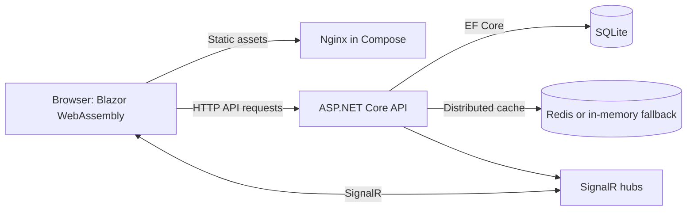

# URL Shortener

URL Shortener is a full-stack link-management application for creating compact links and inspecting how they are used. Users can register, sign in, create generated or custom aliases, set expiry and click limits, and view click analytics such as device, browser, operating system, referrer, and country. Link clicks are broadcast to connected dashboards in real time.

## Highlights

- ASP.NET Core REST API and a Blazor WebAssembly single-page client
- JWT-based registration, sign-in, and per-user link management
- Generated Base62 slugs and user-supplied aliases
- Expiry dates and click limits for short links
- Click analytics with browser/device parsing and country lookup
- SignalR hubs for live dashboard updates
- SQLite persistence, optional Redis distributed caching, and Docker Compose support

## Technology

| Area | Tools |
| --- | --- |
| Backend | ASP.NET Core Web API, .NET 10, C# |
| Frontend | Blazor WebAssembly, Razor, Bootstrap |
| Shared contracts | .NET class library for models and DTOs |
| Persistence | SQLite, Entity Framework Core migrations |
| Caching | Redis when available; in-memory distributed cache fallback |
| Real time | ASP.NET Core SignalR |
| API documentation | OpenAPI and Scalar in Development |
| Testing | xUnit, ASP.NET Core integration testing, EF Core InMemory provider |
| Deployment | Docker, Docker Compose, Nginx for the static frontend |

## Run with Docker Compose

### Prerequisites

- Docker Engine or Docker Desktop with the Compose plugin

From the repository root, build and start the frontend, API, and Redis cache:

```sh
docker compose up --build
```

- **Web app:** [http://localhost:5157](http://localhost:5157)
- **API:** [http://localhost:5112](http://localhost:5112)

The Compose setup stores SQLite data in a named Docker volume. Stop the services with `Ctrl+C`, then remove the containers with:

```sh
docker compose down
```

To also remove the persisted database volume and its contents, use `docker compose down --volumes`.

## Run for development

### Prerequisites

- .NET 10 SDK

Run the API and frontend in separate terminals from the repository root:

```sh
dotnet run --project UrlShortener/UrlShortener.csproj --launch-profile http
```

```sh
dotnet run --project UrlShortener.Frontend/UrlShortener.Frontend.csproj --launch-profile http
```

Open [http://localhost:5157](http://localhost:5157). The frontend is configured to call the API at `http://localhost:5112`; the API's default CORS policy allows the frontend's development origin. The API applies its EF Core migrations at startup and uses SQLite by default. Redis is optional in development: if it is unavailable, the API falls back to in-memory distributed caching.

When running the API in the Development environment, the Scalar API reference is available at [http://localhost:5112/scalar/v1](http://localhost:5112/scalar/v1).

## Tests

Run the test suite from the repository root:

```sh
dotnet test UrlShortener.slnx
```

The current integration tests exercise short-link redirect behavior, including missing and expired links.

## Architecture

The repository is organized into four .NET projects: the API, browser client, shared contracts, and integration tests.



### Projects

- **`UrlShortener`** — ASP.NET Core API, controllers, domain services, repositories, middleware, EF Core context, and SignalR hubs.
- **`UrlShortener.Frontend`** — Blazor WebAssembly user interface and client services; Compose builds the published static assets into an Nginx image.
- **`UrlShortener.Shared`** — models, request/response DTOs, and shared SignalR payload types used by the API and client.
- **`UrlShortener.Tests`** — integration tests using `WebApplicationFactory` and an in-memory EF Core database.

## Engineering details

### Short-code generation

When no custom alias is provided, the service hashes the database ID, a new GUID, and the original URL with SHA-256. It converts the first eight hash bytes to an integer, encodes that number using the Base62 alphabet `0-9A-Za-z`, and checks for collisions before saving the code.

### Redirect and caching flow

Redirect lookup uses a cache-aside strategy with the key `originalurl:{slug}`. A cache miss loads the link from SQLite and checks its expiration date and click limit before redirecting. On a successful visit, the click count is persisted, the relevant cache entries are cleared, and the updated count is broadcast to connected dashboards.

### Analytics and live updates

The redirect endpoint parses the request's user-agent to derive browser, operating system, version, and device details. It also records the referrer and requests a country code from the geolocation service. SignalR hubs deliver dashboard and click information to connected clients without polling.

### Authentication and request protection

Registration and login issue JWTs. Authenticated link operations are scoped to the current user, and link creation uses a fixed-window rate limiter (10 requests per minute). The API uses structured Serilog logging and centralized request/exception middleware.

## Configuration

The main settings are in `UrlShortener/appsettings.json`; environment variables can override .NET configuration values:

| Setting | Purpose |
| --- | --- |
| `ConnectionStrings__DefaultConnection` | SQLite connection string |
| `Redis__ConnectionString` | Redis connection; the API falls back to in-memory caching if unavailable |
| `Cors__AllowedOrigins__0` | Allowed frontend origin |
| `Jwt__Key`, `Jwt__Issuer`, `Jwt__Audience` | JWT signing and validation settings |

The checked-in configuration is suitable for local development. Supply a private signing key and production-specific origins/connection strings through environment-specific configuration or a secret manager when deploying the application.
